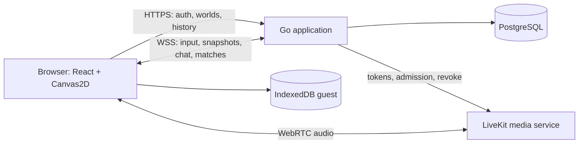

# Patra World Social — Rancangan Produk dan Arsitektur

Tanggal: 26 Oktober 2026. Status: **default rancangan disetujui untuk implementasi melalui goal; eksekusi berlangsung**.

Nama repo sementara: `patra-world-social`. Basis: `/Users/patra/Project/patra-world`, commit `8d969212d91804e06225f5b1a75eed49e8c25307`. Nama dan default rancangan dipilih lewat instruksi goal. Dokumen ini adalah salinan aktif di repo baru; source lama dipertahankan. Lihat `docs/PROGRESS.md` untuk bukti aktual. Remote GitHub dan deployment publik di luar scope goal.

## 1. Arah produk dan keputusan

Membuat tempat nongkrong virtual seperti pengalaman berjalan dan bertemu di Gather, dengan identitas visual Patra World: desa isometrik gelap, pohon autumn, atap ungu, lampu amber, labu, dan karakter kecil. Pengguna berjalan ke arena, berkumpul, bermain, melihat hasil, lalu nongkrong di warkop. Referensi Gather menjelaskan pengalaman sosial; aturan mini-game di bawah adalah rancangan produk ini.

### Sudah ditentukan pengguna

| Kebutuhan | Keputusan tetap |
|---|---|
| Proyek | Repo baru diturunkan dari `patra-world` |
| Tahap sekarang | Implementasi dan verifikasi CP1–CP8; tanpa publikasi produksi |
| Backend | **Golang** |
| Multiplayer | **Dunia privat lewat undangan** |
| Akses | Guest hanya solo; akun username/password dapat multiplayer |
| Sosial | Bisa mengundang teman dan memiliki history |
| Visual | Pertahankan tema yang sekarang; tambah tile/space |
| Race | Area berkumpul; Start ketika tidak ada race berjalan; 5 lap; maksimal 5 pemain; kekurangan diisi bot |
| Penalti | Dua pemain, timer pilihan 3 detik, pilihan kosong menjadi random, tersedia bot |
| Bebek | Arcade shooting, history, papan champion/top 3 |
| Warkop | Meeting space untuk microphone dan chatting |

### Default rancangan yang disetujui melalui goal

- Dunia berkapasitas **20 orang online**, termasuk penonton dan orang yang sedang bermain; jumlah anggota tersimpan maksimal 50. Satu user berada di satu world aktif dan satu game aktif.
- Map hub **64×64 tile**, dengan core village lama dipertahankan sebagai distrik tengah. Ukuran ini target desain pertama, dapat disesuaikan setelah preview.
- Balapan kart arcade; lima slot total termasuk bot, satu lintasan awal, durasi maksimum 300 detik.
- Penalti: lima tendangan per pemain; seri dilanjutkan maksimal lima pasangan sudden death, lalu draw.
- Duck shooting: sesi solo 60 detik; akun bermain melalui server untuk skor resmi, guest latihan lokal.
- “Champion terakhir 3 besar” diartikan sebagai **podium tiga personal best tertinggi** dan **tiga pergantian pemegang rekor terakhir**; bukan turnamen bebek yang belum diminta.
- Dua meja warkop, masing-masing delapan peserta, satu meja per user. Voice audio saja, aktif setelah tindakan pengguna; microphone awalnya mute.
- UI utama bahasa Indonesia; username dan nama arena boleh memakai nama singkat berbahasa Inggris.
- Layanan media usulan: LiveKit Cloud untuk beta; backend aplikasi dan seluruh aturan game tetap Go. Pemilihan layanan berbayar/domain merupakan keputusan saat eksekusi, tidak dilakukan oleh rencana ini.

## 2. Kondisi repo yang menjadi dasar

Pemeriksaan dilakukan terhadap source dan screenshot lokal, bukan asumsi dari nama repo.

| Area sekarang | Kondisi | Arah migrasi |
|---|---|---|
| Frontend | Vite, JavaScript ESM, Canvas2D, React untuk penalty, Tailwind/shadcn | Vite + React dipertahankan; modul baru TypeScript bertahap |
| World | Grid 17×17, playable koordinat 1–15, spawn (8,8) | Geometri menjadi data, map lebih luas, kamera mengikuti pemain |
| Art | Bangunan, pohon, lantern, pumpkin, avatar procedural | Ekstrak fungsi gambar; perluas dengan aset bergaya sama |
| Movement | Lokal, pathfinding, keyboard, click/tap, D-pad | Pisahkan input, simulasi, dan render; server memutuskan posisi online |
| Modal | Membuka dialog menghentikan world lokal | Hanya input lokal yang berhenti; server dan pertandingan terus berjalan |
| Reduced motion | Dapat memindahkan avatar langsung ke tujuan | Di game baru hanya mengurangi animasi, tidak mengubah kecepatan |
| Penalti | Empat zona; lima gol berturut-turut; satu save mengakhiri ronde | Art bisa dipakai ulang; aturan diganti menjadi duel bergiliran |
| History penalti | Best score hanya di memori halaman | IndexedDB untuk guest; PostgreSQL untuk akun |
| Chat | Balasan simulasi lokal | Chat asli dengan lingkup world/table dan otorisasi |
| Hosting | Output statis dilayani Caddy | Tambah Go runtime, database, dan media service |

Referensi source: [package.json](/Users/patra/Project/patra-world/package.json), [world.js](/Users/patra/Project/patra-world/src/world.js), [world-math.js](/Users/patra/Project/patra-world/src/world-math.js), [app.js](/Users/patra/Project/patra-world/src/app.js), [penalty.js](/Users/patra/Project/patra-world/src/penalty.js), [PenaltyGame.jsx](/Users/patra/Project/patra-world/src/components/PenaltyGame.jsx), [deployment lama](/Users/patra/Project/patra-world/docs/DEPLOYMENT.md).

## 3. Pilihan pendekatan

| Pendekatan | Kelebihan | Konsekuensi |
|---|---|---|
| **Go modular monolith + WebSocket + PostgreSQL + media service** | Satu backend aplikasi, aturan terpusat, mudah diuji dan dioperasikan untuk beta | Protokol snapshot/reconnect dan simulasi game perlu dibuat |
| Go API + beberapa layanan game terpisah sejak awal | Bisa diskalakan per game | Koordinasi, deploy, monitoring, dan konsistensi hasil lebih rumit |
| Peer-to-peer game + Go untuk akun/history | Server game lebih ringan | Host keluar dapat mengganggu match; validasi skor dan fairness lebih sulit |

**Rekomendasi rancangan: pendekatan pertama.** Pilihan backend Go berasal dari pengguna; pilihan modular monolith adalah rekomendasi penulis. Tidak ada Node.js runtime untuk backend. Node hanya alat build frontend. Media WebRTC tidak dikirim melalui WebSocket game.

## 4. Struktur dunia dan pengalaman utama

### Tata ruang konseptual

```text
                      RACE PARK
                lobby + tribun + portal track
                           |
   WARKOP -------- CENTRAL VILLAGE -------- PENALTY FIELD
 teras, dua meja      spawn, papan arah       lobby + tribun
                           |
                DUCK ARCADE + CHAMPION PLAZA
                           |
                  TAMAN / EKSPANSI BERIKUTNYA
```

Ini diagram hubungan lokasi, bukan gambar final atau koordinat final. Mini-game memiliki scene sendiri; orang yang tidak ikut tetap dapat nongkrong di hub. Satu world tetap satu komunitas privat meskipun beberapa scene aktif sekaligus.

| Space | Isi dan interaksi | Rancangan ukuran awal |
|---|---|---|
| Central Village | Spawn, core bangunan lama, petunjuk, daftar teman, papan lokasi | Area 20×20 |
| Race Park | Zona kumpul lima kursi, host/ready, status arena, tribun, pintu track | Area 18×14; track scene terpisah |
| Penalty Field | Dua slot pemain, tribun, papan skor, rematch | Area 14×12; pitch scene terpisah |
| Duck Arcade | Empat kabinet aktif paralel, panel skor, podium 1–3 | Area 14×12 |
| Warkop | Warung, teko/kopi, meja kayu, kursi plastik, lampu gantung, dua meja percakapan | Area 18×14 |
| Jalur ekspansi | Jembatan, taman, tempat duduk, batas map yang jelas | Sisa map; tidak semua tile harus terisi |

Dimensi area merupakan footprint perencanaan dan harus ditata tanpa overlap pada map 64×64. Collision bangunan menggunakan footprint nyata, entrance, dan interaction zone; tidak lagi satu tile untuk seluruh bangunan.

- Kamera mengikuti karakter, ada zoom terbatas, tombol kembali ke karakter, minimap, dan daftar lokasi.
- Semua avatar diurutkan menurut kedalaman, diberi nameplate dan indikator status: available, playing, AFK, atau voice.
- Pemain hub tidak menghalangi jalur satu sama lain. Collision berlaku pada lingkungan. Tidak ada teleport bebas menuju teman; tombol “temui” memberi arah/path bila scene sama.
- Race scene memakai mobil mini; penalty dan duck mempertahankan art hangat yang selaras. Tidak perlu pindah ke 3D atau engine lain sebelum profiling menunjukkan kebutuhan.
- Seluruh konten CV/portfolio, biodata karier, galeri proyek, tautan promosi, PDF resume, dan generator CV dikeluarkan dari produk. Area bermain menjadi layar utama; art bangunan lama tetap dikenali dengan nama/fungsi desa.
- Ketik di chat tidak menggerakkan avatar; kontrol sentuh, Escape, focus, mute, dan navigasi lokasi tersedia di luar canvas.

### Alur guest

`Buka → Main sendiri → pilih nama/avatar lokal → masuk map lokal → pilih game → bermain vs bot/latihan → history di perangkat`.

Guest mendapat seluruh lokasi dan tiga game. Warkop dapat dijelajahi tanpa terhubung ke manusia, voice, atau chat online. Tombol “Main dengan teman” mengarah ke daftar/login. History guest maksimal 100 sesi di IndexedDB, dapat dihapus; kehilangan data browser berarti kehilangan history. Saat login, avatar/preferensi boleh disalin, tetapi skor guest tidak pernah menjadi skor resmi.

### Alur akun dan undangan

`Daftar/login → pilih world yang diikuti atau buat world → undang teman → teman login → redeem undangan → masuk world → bermain/nongkrong → hasil tersimpan`.

- World memiliki ID persisten; data anggota, history dan papan skor tetap ada setelah semua orang keluar.
- Daftar world hanya menampilkan milik/keanggotaan sendiri; tidak ada public directory pada versi pertama.
- Undangan dibuka melalui link, username yang sudah terdaftar, atau daftar teman. Pengiriman otomatis hanya notifikasi dalam aplikasi; salin link dilakukan pengguna untuk dibagikan.
- Link default berlaku 24 jam dan satu kali redeem. Token acak minimal 128 bit, hash disimpan, token mentah tidak masuk log. Opsi target username mengikat redeem kepada akun tersebut.
- Login tidak menghabiskan undangan. Keanggotaan baru dibuat setelah redeem sukses; duplikasi request dari akun sama idempotent.
- Jika world penuh, redeem boleh menambahkan membership bila batas anggota belum tercapai; join online menampilkan “dunia penuh” tanpa membuat koneksi/seat tambahan.
- Mencabut link mencegah redeem baru. Mengeluarkan anggota mencabut membership, memutus world/game/voice dan menolak koneksi berikutnya. Keduanya tindakan berbeda.
- Owner tetap owner saat offline; peran host pertandingan berpindah terpisah. Owner dapat mengangkat moderator.

### Akun, teman, dan izin

Username case-insensitive, 3–24 karakter `[a-z0-9_]`; display name 1–32 karakter, avatar dari pilihan yang disediakan. Password 12–128 karakter, tidak di-trim diam-diam. Tidak ada email wajib pada beta; saat daftar tampilkan recovery code sekali. Reset memakai username + recovery code, kemudian ganti code dan batalkan seluruh sesi lama. Tanpa password/recovery code tidak ada reset otomatis berbasis pertanyaan pribadi.

Friend request: cari exact username → kirim → terima/tolak; unfriend dan block. Friend tidak otomatis menjadi anggota world. Block menghentikan request/invite baru dan chat langsung dari user itu; bukan pengganti moderation world. Untuk beta tidak ada DM persisten, hanya undangan/notifikasi, world chat, dan table chat.

| Kemampuan | Guest | Member | Moderator | Owner |
|---|---|---|---|---|
| Solo lokal | Ya | Ya | Ya | Ya |
| Join world/game online/history akun | Tidak | Ya | Ya | Ya |
| Membuat world sendiri | Tidak | Ya | Ya | Ya |
| Membuat undangan ke world ini | Tidak | Tidak | Ya | Ya |
| Membuat/memulai lobby game | Lokal | Ya sebagai host lobby | Ya | Ya |
| Kick/mute chat di world | Tidak | Tidak | Ya, kecuali owner | Ya |
| Ubah moderator, transfer/archive world | Tidak | Tidak | Tidak | Ya |

Profil/history pribadi hanya milik user. Ringkasan pertandingan dunia dan leaderboard terlihat oleh anggota aktif world. Guest tidak dapat mengambilnya melalui API.

## 5. Balapan: lima lap, lima peserta

### Flow dan aturan

1. Pemain masuk Race Park, pilih “Ikut balapan”; antrean tidak terbentuk hanya karena berdiri dekat arena.
2. Pemain pertama menjadi host. Pemain lain bergabung dan menekan Ready. Host dapat mengubah status ready sendiri.
3. Start aktif bila ada minimal satu manusia, semua manusia di lobby ready, dan arena world ini tidak sedang countdown/racing/results.
4. Server memproses Start secara atomik, mengunci roster, mengisi slot kosong sampai **lima peserta total**, lalu menempatkan **seluruh peserta lobby** pada lima posisi start.
5. Countdown **3 detik**. Input tidak menggerakkan mobil sampai waktu start server.
6. Seluruh peserta menjalani **tepat lima lap**. Papan menampilkan lap, posisi, waktu, dan minimap track.
7. Setelah finish, tampilkan posisi 1–5, total waktu, best lap, DNF, dan penanda bot/bot assistance. Hasil ditulis sebelum ditampilkan sebagai tersimpan.
8. Setelah results selama 10 detik atau semua manusia memilih kembali, arena terbuka lagi. Pemain kembali ke pintu Race Park yang aman.

State: `idle → lobby → countdown → racing → finalizing → results → idle`; `aborted` untuk kegagalan server, bukan kemenangan.

- Satu race aktif **per Race Park per world**. World A tidak mengunci World B.
- Kontrol kart: akselerasi, rem, kiri/kanan; kontrol touch tersedia. Kecepatan dan handling semua kart sama.
- Baseline race memakai collision dengan dinding/track, tanpa tabrakan antarkart untuk menghindari griefing dan menyederhanakan networking.
- Lima lap dihitung melalui checkpoint berurutan dan crossing finish dari arah benar. Jalan pintas, bergerak mundur di finish, atau melewati checkpoint yang sama tidak menambah lap.
- Start grid diacak server memakai seed pertandingan; roster/order disimpan. Posisi balap memakai lap, checkpoint, dan progres lintasan, bukan posisi layar.
- Finis diurutkan waktu crossing hasil simulasi server; jika benar-benar sama sampai presisi simulasi, tie-break memakai slot start tersimpan. Aturan ini ditampilkan pada detail bila terjadi seri waktu.
- Batas race 300 detik sejak start. Setelah peserta pertama finis, sisa peserta memiliki paling lama 45 detik, tetap dibatasi 300 detik. Yang belum finis DNF; urutan DNF berdasarkan progres terakhir.
- Pemain keenam dan late join hanya dapat menonton/menunggu, tidak mengganti bot di tengah race. Tidak ada antrean otomatis lintas match pada beta.
- Host meninggalkan lobby → host berpindah ke manusia yang bergabung paling awal. Lobby kosong dibubarkan. Host keluar setelah start tidak menghentikan race.
- Disconnect: kontrol netral segera, bot mengambil alih saat disconnect terdeteksi, seat disimpan 15 detik. Reconnect pada grace mengambil seat sama; history diberi `botAssisted=true`. Lewat grace/keluar sengaja → pemain DNF; bot pengganti dapat menyelesaikan visual race tetapi hasilnya tidak diklaim sebagai kemenangan manusia.
- Jika semua manusia sudah keluar permanen, match diakhiri abandoned, arena dilepas, tidak menjalankan bot tanpa batas.

### Bot

Bot mengirim input melalui simulator yang sama, mengikuti racing line/checkpoint, dengan sedikit variasi konsistensi. Bot tidak teleport, melewati collision, atau mendapat kecepatan lebih tinggi. Beta satu difficulty “normal”; tuning wajib menghasilkan lawan yang dapat dikalahkan pemain baru. Race satu manusia otomatis berisi empat bot. Bot berlabel BOT pada lobby, avatar, dan hasil.

## 6. Penalti: duel dengan pilihan tiga detik

Gunakan empat zona existing: kiri atas, kanan atas, kiri bawah, kanan bawah. Art gawang/bola/kiper dipakai ulang; aturan streak lama tidak menjadi aturan duel.

1. Pemain membuat duel di Penalty Field. Slot lawan dapat diisi teman atau tombol “Lawan bot”. Jangan mulai otomatis sebelum pemain memahami lawannya bot.
2. Dua manusia menekan Ready; host Start. Untuk bot, manusia ready cukup. Satu duel aktif per field/world pada beta.
3. Server menentukan urutan penendang pertama secara acak. Setiap tembakan, penendang memilih target dan kiper memilih arah **secara rahasia dan bersamaan**.
4. Waktu memilih **3.000 ms** dari `choiceOpensAt` hingga `choiceDeadlineAt` server. Pilihan pertama valid dikunci; tidak dapat diganti.
5. Saat deadline, pilihan yang kosong diacak uniform ke empat zona oleh server, sekali saja. Pilihan yang sudah ada tetap dipakai. Kedua pihak timeout berarti dua pilihan independen.
6. Reveal selalu pada deadline, kemudian animasi 1.500 ms. Zona sama = save; berbeda = gol. Animasi bukan pemicu perhitungan skor.
7. Pemain bergantian menendang. Masing-masing mendapat lima tendangan; duel boleh selesai dini jika lawan tidak mungkin menyamai skor.
8. Seri setelah lima per pemain → sudden death per **pasangan** tendangan. Maksimal lima pasangan tambahan; bila tetap seri hasil draw. Tidak menang setelah satu tendangan sudden death sebelum lawan mendapat kesempatan setara.
9. Hasil: menang/kalah/draw, skor, detail tiap tendangan, pilihan otomatis, lawan manusia/bot. Rematch dua manusia harus disetujui keduanya.

State: `waiting → ready → choosing → reveal → animation → choosing/ finalizing → results`.

- Pilihan lawan tidak ada dalam public snapshot, spectator payload, analytics atau log debug. Sebelum reveal hanya status “sudah memilih”. Bot tidak membaca pilihan manusia.
- Input tepat pada atau setelah deadline ditolak; server menerima hanya ketika `receivedAt < deadline`. Timer UI mengikuti estimasi clock server, bukan clock perangkat.
- Setiap command membawa `matchId`, `turnId`, `commandId`; pilihan kedua/turn lama/duplikat ditolak atau mendapatkan ack hasil lama tanpa mutasi baru.
- Disconnect tidak menghentikan deadline. Grace 15 detik; fallback random bekerja selama grace. Setelah grace, pemain yang pergi forfeit. Dua manusia sama-sama pergi → abandoned. Jika match sudah berakhir alami sebelum grace, hasil alami tetap berlaku.
- Bot pengganti tidak mengubah pertandingan PvP menjadi kemenangan PvP normal. Setelah forfeit pengguna dapat membuat pertandingan practice baru.
- Keluar modal saat duel berjalan bukan Restart. UI menawarkan kembali ke pertandingan atau keluar dengan konsekuensi forfeit.

## 7. Duck Arcade dan champion

### Gameplay pertama

- Empat kabinet per world; satu sesi per kabinet dan satu pemain per sesi. Pemain lain dapat menonton dari world yang sama. Slot kabinet dilepas setelah results/abort.
- Countdown 3 detik, bermain 60 detik. Aim dengan pointer/touch; keyboard alternatif menggerakkan crosshair dan Space menembak.
- Target normal 100 poin, cepat 200, bonus emas 500. Spawn interval 700 ms, pola/kecepatan dari seed server, maksimum delapan target aktif. Setiap target hidup maksimum 2,5 detik. Parameter ini versi ruleset `duck-v1` dan perlu playtest sebelum dikunci rilis.
- Cooldown tembakan 250 ms, tanpa reload pada versi pertama. Satu tembakan maksimal satu target; overlapping target dipilih yang terdepan sesuai urutan render yang sama pada server.
- Tidak ada combo dahulu. Miss bernilai nol, shots tetap bertambah. Akurasi = hits/shots; nol shot berarti akurasi nol.
- HUD: waktu, skor, hits, accuracy. Saat 60 detik selesai server menutup input dan menghitung hasil.

### Skor sah dan podium

- Client mengirim koordinat bidikan dan input sequence. Client tidak mengirim nilai skor sebagai hasil yang dipercaya.
- Server menentukan spawn, posisi target, hitbox, cooldown dan hit; target hanya dapat terkena sekali. Seed/pola masa depan tidak disiarkan ke client.
- Validasi lag memakai snapshot target historis: server mengestimasi waktu tampilan dari offset/RTT yang diukur dan membatasi rewind **maksimal 150 ms**. Timestamp client harus monoton dan berada dalam jendela tersebut; tidak dapat menentukan waktu arbitrary.
- Sebelum rilis, uji pada RTT 50/100/200 ms dan jitter. Untuk RTT terlalu tinggi tampilkan indikator koneksi; jangan mengunggah klaim “anti-cheat sempurna”. Validasi server tidak mencegah seluruh aimbot.
- Leaderboard private per `worldId + gameType + rulesetVersion`, satu personal best per user. Podium tiga akun unik; bot dan guest tidak masuk.
- Urutan: skor terbesar → akurasi tertinggi → waktu pencapaian paling awal → ID hasil sebagai penentu stabil. Bandingkan akurasi rasional, bukan rounding tampilan.
- Panel “Juara Terakhir” mencatat pergantian pemilik posisi #1. Top score pertama menciptakan champion pertama; pemilik yang sama meningkatkan skornya tidak dihitung sebagai pergantian. Tampilkan tiga pergantian terbaru. Jika belum cukup data, tampilkan slot kosong, bukan pemain fiktif.
- UI menampilkan personal best, top 3, dan hasil sesi terakhir. History menyimpan setiap sesi valid, bukan hanya high score.
- Perubahan aturan/skor membuat ruleset baru agar hasil lama tidak tercampur. Season mingguan tidak wajib pada beta.
- Putus koneksi lebih dari 15 detik atau keluar sengaja → aborted/incomplete, history ada tetapi tidak eligible leaderboard. Reconnect singkat melanjutkan waktu yang terus berjalan; tidak ada pause untuk ranked.
- Jika waktu normal 60 detik berakhir selama grace disconnect, hasil alami tetap valid berdasarkan tembakan yang sudah diterima server. Contoh: disconnect pada detik 59, selesai pada detik 60 → complete; disconnect pada detik 40 dan belum kembali pada detik 55 → incomplete. Jika akhir normal sama persis dengan batas grace, akhir normal diprioritaskan. Menutup lewat tombol keluar tetap incomplete, bukan disconnect sementara.

## 8. Warkop: voice dan chat

Visual: warung kecil dengan papan menu, teko, kursi plastik, meja kayu, lampu hangat, teras dan tanaman. Dua meja diberi nama “Meja Depan” dan “Meja Pojok”. Masing-masing delapan kursi; bukan dua server berbeda.

### Voice

- Jalan ke meja → pilih “Gabung obrolan” → server mengalokasikan kursi → audio tersambung, mic tetap mute → pilih “Nyalakan mic” untuk permission dan publish.
- Tidak meminta microphone ketika halaman pertama dibuka. Jika izin ditolak, pengguna tetap dapat membaca chat dan, jika browser mengizinkan playback, mendengarkan setelah tombol bergabung.
- Kontrol: mute/unmute, push-to-talk opsional, pilih input, volume, indikator sedang bicara, deafen, keluar meja. Hotkey tidak aktif ketika mengetik.
- Audio hanya satu meja. Tidak terdengar ke meja lain, hub, game, atau world lain. Perpindahan meja melepaskan koneksi lama sebelum memasuki yang baru.
- Masuk game, keluar world, logout, kick, session expired, atau berjalan keluar area meja → cabut seat dan media membership. Voice tidak terus menyala tersembunyi.
- Moderator dapat mute secara server dan mengeluarkan peserta; unmute selalu tindakan peserta. Host meja berpindah ke peserta terlama ketika host pergi.
- MVP tidak memiliki locked table, video, screen sharing, voice recording, atau transkripsi. Dunia sudah privat; locked meeting khusus dapat ditambah sesudah alur voice stabil.
- Kegagalan voice tidak memutus game dan text chat. UI membedakan kegagalan izin, perangkat, dan jaringan.

Go mengeluarkan token media berumur singkat dengan identity user, room spesifik, dan hak microphone-only. Token hanya diberikan jika akun masih punya membership world dan seat meja. Saat keluar/kick, server menghapus peserta media dan mencabut kemampuan rejoin; TTL saja tidak cukup untuk memutus audio yang sudah aktif. Detail revocation provider wajib diuji sebelum beta.

Default implementasi Cloud: TTL token awal 60 detik; identity media berupa ID admission acak yang dipetakan ke user, bukan username, dan berubah setiap join sah. Gunakan `RemoveParticipant` dengan `revoke_token_ts` eksplisit saat mencabut admission, bukan cutoff default. Dokumentasi Cloud menyebut buffer default dapat membolehkan token baru dipakai kembali, refresh token dapat bertahan sepuluh menit, dan revocation berlaku sepuluh menit. Uji replay token awal maupun token refresh setelah kick. Self-host tidak menyediakan revocation yang sama; tidak dianggap pengganti langsung sebelum ada mekanisme admission/revocation setara. [Token lifecycle dan revocation LiveKit](https://docs.livekit.io/frontends/reference/tokens-grants/). Integrasi Go memakai [SDK Go resmi](https://github.com/livekit/server-sdk-go/blob/main/README.md).

Browser memerlukan secure context dan permission untuk akses microphone; deployment voice harus memakai HTTPS. [MDN getUserMedia](https://developer.mozilla.org/en-US/docs/Web/API/MediaDevices/getUserMedia).

### Chat

| Kanal | Penerima | Penyimpanan default |
|---|---|---|
| World chat | Anggota yang online pada world itu; anggota dapat membuka history | 30 hari, paginasi 50 pesan |
| Table chat | Peserta meja yang sama selama sesi meja | Memori; dihapus lima menit setelah meja kosong |
| Match events | Peserta/penonton match dalam world | Hanya event sistem dan hasil; bukan kanal chat baru |

Pesan maksimal 500 karakter, plain text dengan render aman. Rate limit awal lima pesan per lima detik per user, burst lima. Pesan memiliki `clientMessageId` dan server ID untuk deduplikasi/reconnect. Reply/pin/reaction/attachment ditunda. Moderator dapat menghapus pesan dan mute world-chat user selama durasi tertentu; aksi dicatat tanpa merekam audio.

## 9. Arsitektur Go dan kontrak multiplayer



### Modul dan teknologi usulan

- Go `net/http` untuk REST, `github.com/coder/websocket` untuk WebSocket, `pgx` untuk PostgreSQL, `sqlc` untuk typed queries, migrasi SQL berurutan. Versi kompatibel dipilih dan dikunci saat bootstrap, tidak menebak versi terbaru sekarang.
- Paket domain: auth, friends, worlds/invites, realtime, lobby, race, penalty, duck, history, leaderboard, chat, voice, moderation.
- Satu proses Go awal, satu owner goroutine per world/match untuk serialisasi command. I/O database dan media lewat worker/timeout terpisah, bukan blocking dalam tick loop.
- WebSocket library menangani transport; aplikasi tetap membuat sequence, ack, reconnect, snapshot, idempotency dan room authorization. [Coder WebSocket](https://github.com/coder/websocket), [referensi API](https://pkg.go.dev/github.com/coder/websocket).
- PostgreSQL menjadi sumber data akun, membership dan hasil. Redis tidak wajib pada satu instance; baru dipertimbangkan ketika multi-instance perlu routing/presence/rate limit terdistribusi.
- JSON di awal untuk debugging; binary protocol hanya jika hasil profiling memerlukan. Map/ruleset/schema memakai version dan checksum.
- Guest memakai engine TypeScript lokal. Online memakai Go. Kedua implementasi membaca map/rules JSON serta golden fixtures yang sama; kode Go tidak diasumsikan dapat diimpor langsung oleh browser.

### Ritme simulasi dan kontrol

| Sistem | Baseline rancangan |
|---|---|
| Hub movement | Fixed tick 20 Hz; snapshot 10 Hz |
| Race | Fixed tick 30 Hz; snapshot 15 Hz |
| Penalty | Deadline/event driven; server clock |
| Duck | Simulasi 30 Hz; snapshot target 15 Hz |
| Render browser | Target 60 fps desktop; minimal 30 fps perangkat mobile uji |

Ini target awal, bukan hasil benchmark. Input berurutan dan dibatasi rate. Server menghitung posisi/collision/speed; frontend interpolation dan local prediction tidak menentukan hasil. Intent gerak kedaluwarsa setelah 250 ms tanpa pembaruan sehingga input tidak tersangkut ketika tab tidur. Click-to-walk mengirim tujuan; server memvalidasi path dan pemain dapat membatalkan dengan input arah.

### Protokol

Envelope command: `{v, commandId, seq, worldId, type, payload}`. Event: `{v, eventId, serverTick, serverTimeMs, type, payload}`. `worldId` dari client selalu dicocokkan dengan session, tidak dipercaya sebagai izin.

| Client command | Server event/hasil |
|---|---|
| `world.join`, `world.leave` | `world.snapshot`, `presence.changed` |
| `player.input`, `player.destination`, `player.interact` | `world.delta`, `command.ack` |
| `lobby.join`, `lobby.ready`, `lobby.leave`, `match.start` | `lobby.updated`, `match.started` |
| `race.input` | `race.snapshot`, `race.finished` |
| `penalty.choose` | `penalty.choice_ack`, `penalty.turn_opened`, `penalty.revealed` |
| `duck.shoot` | `duck.shot_resolved`, `duck.snapshot` |
| `chat.send` | `chat.message`, `command.error` |
| `voice.join`, `voice.leave` | `voice.seat_granted`, `voice.seat_revoked` |
| `session.resume` | Full snapshot + hasil/event persisten yang terlewat |

Snapshot publik berbeda dari state internal; pilihan penalti, token, hash password, dan data world lain tidak boleh diserialisasi. Satu reader, satu bounded writer queue per koneksi. Snapshot lama boleh digabung/dibuang saat backpressure; event hasil/chat harus ack atau dipulihkan dari database. Slow client diputus dengan alasan lalu dapat resync, tidak membuat memori tumbuh tanpa batas.

Reconnect membutuhkan session valid, membership, connection epoch dan seat yang cocok. Grace game 15 detik; world presence dihapus setelah 30 detik tanpa koneksi. Socket lama difence ketika socket baru aktif agar dua tab tidak mengendalikan satu avatar. Jangan menghidupkan kembali hak akses yang sudah dicabut.

## 10. Data, history dan finalisasi

| Tabel | Isi inti |
|---|---|
| `users`, `profiles` | Username canonical unik, password hash, display/avatar, status |
| `sessions`, `recovery_codes` | Hash token, user, expiry/revocation, recovery sekali pakai |
| `friendships`, `user_blocks` | Request/accept, pasangan user unik, block |
| `worlds`, `world_memberships` | Owner, map version, role, membership status |
| `world_invites` | Hash token, target, expiry, redeemed user, revoked time |
| `world_bans` | User yang dilarang join/redeem kembali ke world |
| `matches`, `match_participants` | Game/ruleset/map, start/end/status, user/bot, skor/posisi/flags |
| `penalty_turns` | Hasil pilihan per turn setelah resolve, timeout flags |
| `race_results`, `duck_results` | Lap/time/DNF; score/hits/shots/accuracy |
| `leaderboard_entries`, `champion_changes` | Best resmi dan histori pergantian #1 |
| `chat_messages`, `moderation_actions` | World chat, deletion/mute/kick audit |
| `result_jobs` | Hasil akhir immutable yang sudah durable dan perlu diproyeksikan |

UUID dipakai untuk ID publik; timestamp disimpan UTC dan ditampilkan sesuai timezone pengguna. Bot bukan akun user; peserta memiliki `actorType=human|bot`, `userId` nullable untuk bot.

- History akun: game, waktu, world, lawan/anggota, status, skor/posisi, durasi, aturan yang dipakai, BOT/assisted, detail hasil. Filter game/world/tanggal/status dan pagination.
- Histori per-user bersifat privat. Leaderboard world menampilkan ringkasan yang disepakati dan tidak membuka history akun di world lain.
- Match record dibuat `running` sebelum start resmi. Setelah selesai, hasil masuk `finalizing`; tulis `result_jobs` durable, lalu transaksi memfinalisasi match, detail, personal best dan champion. ID match unik menjamin retry tidak menggandakan hasil.
- Serialisasi pembaruan leaderboard per world/ruleset memakai row lock/transaction agar dua skor bersamaan menghasilkan urutan champion konsisten.
- Bila PostgreSQL tidak tersedia, pertandingan baru tidak dimulai. Match yang sudah berjalan boleh selesai dengan status “hasil belum tersimpan”; finalisasi menunggu/retry sampai 60 detik tanpa mengklaim tersimpan atau masuk leaderboard.
- Setelah 60 detik, arena dilepas dan UI menunjukkan **“hasil belum dapat dikonfirmasi”**. Batalkan write yang masih berjalan dengan context dan simpan daftar ID yang perlu direkonsiliasi, terbatas pada match aktif ketika gangguan dimulai; tetap tolak match baru sampai database pulih dan rekonsiliasi selesai. Jangan langsung menyatakan aborted karena write timeout dapat berarti commit sukses tetapi ack hilang. Saat database pulih: jika job/hasil durable ada, lanjutkan finalisasi; jika tidak ada, tandai `aborted_storage`, tanpa leaderboard. Full state/render memory boleh dilepas setelah fase ini. Jika proses crash sebelumnya, startup memakai aturan `aborted_server` untuk running tanpa job; tidak menjanjikan hasil yang belum durable dapat dipulihkan.
- Tidak ada janji recovery state game penuh pada beta. Setelah process crash, match `running` tanpa hasil durable ditandai `aborted_server`; tidak ada pemenang/rekor palsu. Job hasil yang sudah durable diproses ulang saat restart.
- Hasil resmi baru ditampilkan sebagai tersimpan setelah commit sukses. UI dapat menampilkan hasil sementara selama finalizing dengan label jelas.
- Match/account history disimpan sampai user menghapus akun/owner mengarsipkan world sesuai aturan produk; tidak ada purge diam-diam. Archive world menghentikan join baru dan mempertahankan history personal. Penghapusan akun mencabut sesi, menganonimkan actor pada history lawan dan menghapus profil/leaderboard miliknya; jika owner, harus transfer atau archive world lebih dulu.
- Telemetry tidak berisi password, recovery code, bearer token, pilihan rahasia sebelum reveal, isi voice atau isi table chat.

## 11. Keamanan dan batas akses yang relevan

- Password memakai Argon2id dan salt acak. Baseline minimum `m=19456 KiB, t=2, p=1`; benchmark dan tingkatkan sesuai CPU/RAM server. Jangan gunakan SHA-256 untuk password. [OWASP Password Storage](https://cheatsheetseries.owasp.org/cheatsheets/Password_Storage_Cheat_Sheet.html).
- Session berupa opaque token acak 256 bit dalam cookie `HttpOnly; Secure; SameSite=Lax`; database menyimpan hash token. Absolute expiry tujuh hari, idle expiry 24 jam; aktivitas socket yang sah ikut memperbarui idle, bukan setiap render.
- Login/reg/reset mempunyai rate limit per IP dan akun. Username tersedia boleh diketahui saat daftar, tetapi respons login/reset tidak membocorkan apakah password/recovery salah pada akun tertentu. Batasi hashing concurrent agar endpoint tidak menghabiskan RAM.
- REST mutasi memakai CSRF token dan validasi origin. WSS memeriksa exact origin allowlist, cookie session, membership dan status ban. Logout/session expiry menutup socket dan voice; pemeriksaan hak bukan hanya saat handshake. [OWASP WebSocket Security](https://cheatsheetseries.owasp.org/cheatsheets/WebSocket_Security_Cheat_Sheet.html).
- Rate limit frame/input, ukuran payload maksimum 16 KiB untuk command client, validator enum/range/string. Batas awal 60 movement commands/detik dan 10 control commands/detik; chat memakai limit sendiri. Server snapshots dapat lebih besar sesuai limit outbound terukur.
- Guest ditolak untuk world join, invite redeem, history akun, score resmi, dan token voice walaupun memanggil API langsung.
- Operasi world, ringkasan match dunia, leaderboard, world chat, dan media memeriksa membership aktif. **History pribadi** memeriksa bahwa user adalah peserta hasil tersebut, sehingga tetap bisa dibaca setelah keluar/dikeluarkan dari world atau world diarsipkan. Detail pribadi menampilkan data pertandingan yang memang diikuti, bukan chat/history peserta di match lain. UUID yang sulit ditebak tidak menggantikan otorisasi.
- Tidak ada currency, taruhan, pembayaran, atau hadiah uang dalam scope.

## 12. Deployment dan operasi

Repo baru memiliki frontend static, satu Go binary, PostgreSQL, dan konfigurasi media service. Domain/subdomain dan direktori deployment berbeda dari portfolio lama. Jangan menyalin script deploy lama dengan destination yang sama.

- Untuk development: Go + PostgreSQL lokal/Compose + Vite. Seed akun/world hanya lingkungan development, tidak membawa password tetap ke production.
- Untuk beta: Caddy melayani frontend dan reverse-proxy `/api` serta `/ws` ke Go pada origin yang sama. Database tidak dibuka ke internet. HTTPS untuk game dan voice.
- LiveKit managed mengurangi pekerjaan operasi media. Jika dipilih self-hosted, SFU/TURN/firewall/UDP/sertifikat dan uji jaringan seluler menjadi pekerjaan tambahan tersendiri; bukan sekadar menambah route Caddy.
- Health endpoint dipisahkan readiness database dan liveness proses. Ukur active worlds/connections/matches, tick duration, command queue, disconnect, reconnect, write failures, voice join failures dan bandwidth.
- Structured logs memakai request/match/world ID tanpa secret. Backup database harian, target awal RPO 24 jam dan RTO empat jam; lakukan uji restore sebelum beta.
- Deployment game melakukan drain: tolak match baru, tunggu match berjalan maksimal batasnya, kemudian ganti proses. Frontend/backend protocol version harus cocok; client lama diminta refresh dengan jelas.
- Migrasi database kompatibel dengan release sebelumnya. Rollback binary tidak boleh menghapus history baru atau menjalankan down migration destruktif otomatis.
- Kapasitas beta yang harus dibuktikan: **3 world × 20 user = 60 user game terkoneksi**, masing-masing satu race, satu penalty, empat duck sessions; voice diuji terpisah sampai dua meja × delapan peserta per world. Ini target validasi, bukan klaim VPS sekarang sanggup.
- Tidak ada angka biaya hosting dalam plan karena spesifikasi mesin, region, provider dan durasi voice belum dipilih. Estimasi media memakai total participant-minutes, bandwidth, peak concurrent, kemudian pricing resmi pada saat pemilihan.

## 13. Pengujian dan kriteria selesai

| Area | Skenario penerimaan wajib |
|---|---|
| Tema/map | Core world dikenali, empat distrik terhubung, tidak ada spawn terperangkap, kamera/zoom readable di mobile |
| Guest | Semua game lokal jalan; API online menolak guest; skor lokal tidak dapat diupload sebagai ranked |
| Auth/invite | Username case-insensitive; token expiry/revoke; dua redeem satu token; world penuh; reset membatalkan sesi |
| Multiplayer | Dua tab tidak menguasai satu avatar; reconnect resync; world A tidak menerima data B; reduced motion tidak teleport |
| Race | 1 manusia+4 bot; 5 manusia; pemain keenam; double Start; tepat 5 lap; checkpoint skip; DNF; host keluar |
| Penalty | 16 kombinasi zona; timeout salah satu/keduanya; deadline boundary; pilihan tersembunyi; five kicks dan sudden death adil |
| Duck | Hit ganda, target mati, tembakan terlalu cepat, replay input, rewind di luar batas, tie-break leaderboard konsisten |
| Voice | Izin ditolak, mic mute awal, lintas meja tak terdengar, keluar/kick menghentikan audio dan rejoin token lama ditolak |
| History | Finalisasi dua kali hanya satu hasil; database down; restart server; champion update serentak |
| UX | Keyboard/touch, focus dialog, chat tidak menggerakkan avatar, tab background tidak menghentikan match |

Pengukuran target: p95 processing tick di bawah interval tick; frame ≥30 fps pada perangkat mobile uji yang dicatat; soak 60 menit tanpa pertumbuhan goroutine/queue/memori tak terkendali; browser Chrome, Firefox, Safari desktop serta Android Chrome/iOS Safari diuji. Hasil nyata dan hardware dicatat, bukan diasumsikan dari tes unit.

## 14. Urutan rilis dan estimasi

Estimasi kasar untuk satu engineer full-time berpengalaman dengan QA/playtest ringan, bukan komitmen kalender. Pekerjaan visual, jaringan mobile dan voice dapat mengubah estimasi.

| Milestone | Hasil yang bisa dicoba | Kisaran kerja |
|---|---|---|
| M0 — baseline baru | Repo terpisah, visual sumber terjaga, build/CI, schema map/rules | 3–5 hari |
| M1 — private social world | Auth, membership/invite, avatar realtime, map luas, teman/chat | 10–15 hari |
| M2 — penalty + history | Duel manusia/bot, timer 3 detik, hasil persisten | 4–6 hari |
| M3 — race | Lobby, lima kart/lap, bot, checkpoint, reconnect | 8–12 hari |
| M4 — duck arcade | Shooting tervalidasi, podium dan champion history | 5–8 hari |
| M5 — warkop | Dua meja, voice, moderation, network testing | 4–7 hari |
| M6 — beta | Optimasi, mobile, security, soak, backup/restore, deploy terpisah | 6–10 hari |

Total kasar **40–63 hari kerja (sekitar 8–13 minggu)** untuk keseluruhan beta. Milestone dapat dipreview lebih awal; paralelisasi tidak otomatis memangkas separuh karena kontrak/auth/realtime saling bergantung. Jika waktu harus dipadatkan, kurangi polesan/avatar/variasi track dahulu; jangan mengurangi server validation, isolasi world atau penyimpanan hasil yang benar.

### Setelah beta, bukan syarat rilis awal

Proximity voice di seluruh map, meja terkunci/meeting terjadwal, screen share/video, map editor, avatar cosmetics, additional tracks, party matchmaking lintas world, turnamen duck, seasons/achievements, replay penuh dan world publik. “Dan lain-lain” pada kebutuhan awal diterjemahkan menjadi teman, presence, history, personal best, settings dan moderation dasar; fitur lain tetap backlog agar scope terukur.

## 15. Keputusan yang dapat direvisi saat review

Nama `patra-world-social`; kart untuk race; 20 pemain/world; map 64×64; format lima tendangan penalti; definisi podium/juara terakhir bebek; dua meja delapan orang; LiveKit Cloud; recovery code tanpa email. Default ini disetujui melalui goal untuk dikerjakan; perubahan kebutuhan utama tetap diklarifikasi.

Keputusan pengguna yang mengikat tetap: **Go, dunia privat berundangan, guest solo, tema existing, race 5 lap/maksimal 5, penalti 3 detik, duck history/top 3, warkop mic/chat, serta scope eksekusi CP1–CP8 tanpa publikasi produksi.**

## Klarifikasi scope — 26 Oktober 2026

Pengguna meminta seluruh konten CV/portfolio dikeluarkan dari produk baru. UI, aset publik, dialog lokasi, dan build hanya berfokus pada eksplorasi desa, game, teman, history, serta warkop. Tema visual dipertahankan. Referensi asal-usul kode dalam dokumentasi historis tidak menjadi konten produk.
